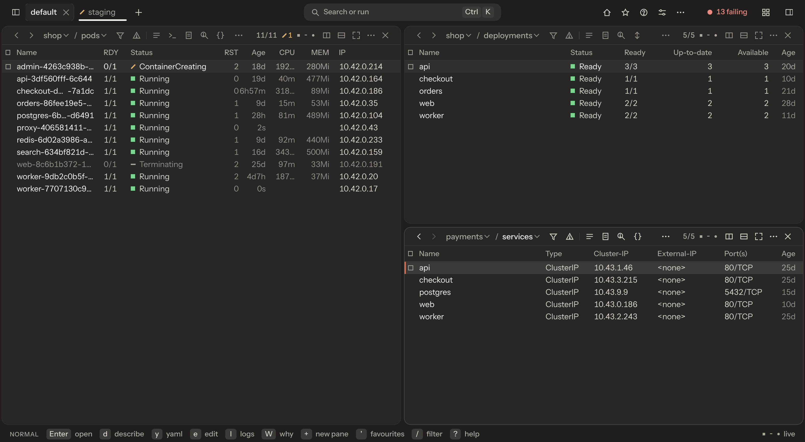
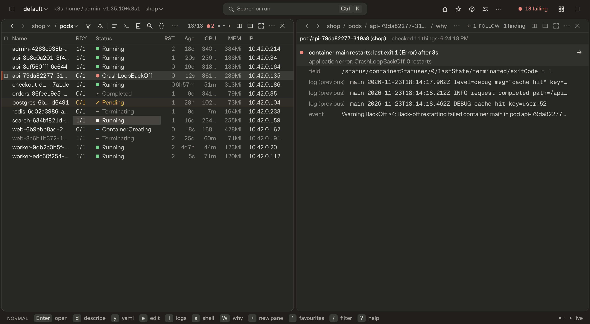
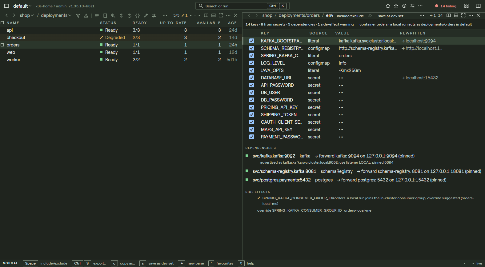
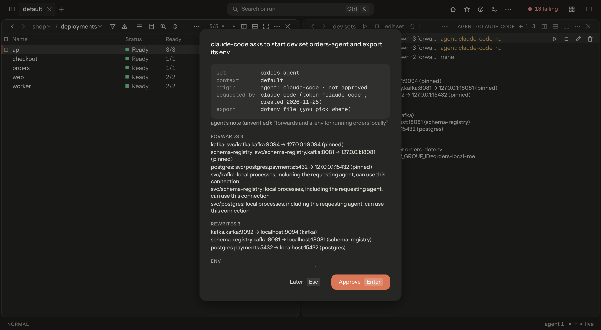
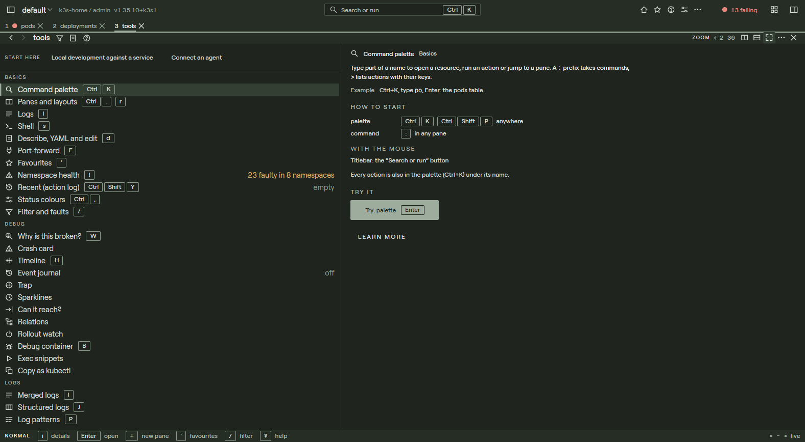

# kns

kns is a graphical k9s: a keyboard-first Kubernetes desktop app for Windows and macOS. It keeps the k9s idea of driving everything from the keyboard, and adds what a terminal makes hard: split panes, virtualized tables, a real YAML editor with server dry run, a diagnosis view that explains why something is broken, tools for running a service locally against the cluster (port-forwards plus a rewritten `.env`), and a local MCP server so a coding agent can look at the cluster and ask for changes that you approve in the kns window. It is built with Tauri 2 (Rust, kube-rs) and React 19 / TypeScript, starts fast, stays small and updates itself from GitHub Releases.



## Features

Keys below are the defaults (all rebindable). `Mod` is `Ctrl` on Windows and `⌘` on macOS; `leader` is `Mod+.` followed by one key. Every feature, with its keys, mouse paths and an example, is in [docs/tools.md](docs/tools.md), and in the app in the Tools hub (`Mod+Shift+H`, `leader g` or `:tools`).

### Navigate

- `Mod+K` palette for resources, actions and objects; `:` command bar with completion (`:pods shop`, `:deploy`, `:svc payments`).
- Context and namespace pickers (`Mod+Shift+K`, `Mod+N`), namespace slots `0`–`9` in a table.
- Context tabs: every context you switch to is a tab in the titlebar (`Ctrl+Tab` to step, `Ctrl+F4` / `⌃⌘W` to close). Tabs not on screen stay warm (connection, table watches, running shells), and each tab lands where you left it. Give a context a short alias (double-click its tab, `:ctx alias prod`) and use it in `:ctx prod` and `:pods @prod`; drag tabs to reorder.
- Tables with server columns, sort, `/` filter (regex, inverse, label, fuzzy), `!` faults only, `Space` to mark rows, live CPU/memory for pods.
- `d` describe, `y` YAML, `e` edit with a diff gutter, then review against a server dry run, three-way rebase on conflict, apply.
- Panes: `+` opens the next view beside the current one, `leader r` / `leader d` split, `Alt+h/j/k/l` or `Alt+arrows` move focus (`Alt+⌘+arrows` on macOS), `leader z` zoom, `leader x` close. Workspace per context is restored on start.
- Panes in different contexts: `Ctrl/⌘+Enter` in the context picker opens the pane's view beside it in that context, `leader C` changes the focused pane's context, `:pods @staging` too. Reads, RBAC, write tiers and the protected line follow each pane's context.
- Favourites: `Mod+Shift+S` saves a view, `Mod+1..9` recalls it; `Mod+Shift+L` saves a layout, `Alt+1..9` recalls it; `'` opens the picker.
- Organisation catalog (optional, [docs/catalog.md](docs/catalog.md)): a Backstage-style file of teams, systems and environments. Team members who may only use a few namespaces get their team's namespaces in pickers, "all namespaces" tables and health; rows name the system and team; the sidebar shows the system's owner, links and repositories; `:env prod` moves a view to another environment; `:deploys` lists what each environment of a system runs (from its ops repository, through the GitHub CLI) beside the live version, with the commits and PRs between prod and test.
- Namespace health: a badge per namespace in the context sidebar (`Mod+B`), `!` on a namespace row opens its faults, `:faults` for all of them. Recent actions in the activity panel (`Mod+J`).

### Debug



- `W` (`:why`) on a pod, workload, Service, Ingress, Job, CronJob or Flux object: deterministic findings with the evidence (status fields, events, log lines) you can follow.
- `l` logs (follow, previous, search, merged logs of marked rows), `J` structured logs with field chips, `P` log patterns; `s` shell; `F` port-forward.
- `H` timeline of events, restarts and rollouts; `:journal on` keeps events past the API server's TTL; `:trap` saves a redacted incident bundle when a pod dies.
- `:reach web:80` checks Service, endpoints, ports, NetworkPolicies and DNS, then optionally probes from inside the pod; `:relations` shows owners up to the Flux source, traffic and what an object uses.
- `D` diffs two marked rows; `:diff prev` and `:diff applied`; `O` field owners and `:drift` in YAML (fields a Flux reconcile will fight over).
- `B` debug container, `:x` exec snippets, `:kubectl` copies the equivalent kubectl command.
- Flux: `R` reconcile, `T` suspend/resume, `Mod+Shift+R` reconcile with source.
- Pod traffic: `:traffic` on a pod or deployment shows who it talks to, in and out (Services, pods by workload, nodes, external addresses) and what it listens on, from its socket table read every few seconds.
- Argo CD: objects an Application applied say so (describe, `:relations`, field owners, `:drift`, a warning before an edit Argo will revert), read from the tracking annotation, so it works without access to the Applications. Where they are served: `:argo` with sync and health status, `W`, `R` refresh, `Y` sync.

### Local development



- Forwards to pods, Services and workloads on a stable local port with failover across a rollout; `:pf` lists them (`o` open in browser, `C` connection string).
- `E` on a workload opens its env: every key with its source (literal, ConfigMap, Secret), in-cluster addresses rewritten to local forwards, Kafka listener awareness, and side effects of running it locally (consumer groups, migrations) with suggested overrides. `Mod+S` exports a `.env`, `s` saves the whole thing as a dev set.
- Dev sets (`leader e`, `:dev`): named groups of forwards plus an env export config; `u` starts one, `x` stops it.
- `:dev names on` serves `http://<service>.<namespace>.localhost:7080` on one port; on Windows a forward can get its own loopback address (`127.0.1.x`) and keep its port.
- `:mirrord` copies a mirrord command for the workload.

### Agents (MCP)



- A local MCP server on `127.0.0.1` (`:mcp setup`) with 18 read tools (status, selection, objects, events, logs, `explain_why`, timeline, dependencies, packs …) and 13 tools that draft dev sets or ask for changes.
- An agent never changes anything itself: forwards, env exports, scale, restart, delete, reconcile and apply arrive as requests you review with `leader y`.
- `leader c` (`:pack`) copies a redacted markdown bundle of the marked objects for pasting into any agent.

### Keyboard and mouse



- One keymap: hint row at the bottom, `?` help, which-key panel after the leader, keymap editor in settings (`Mod+,`), a k9s-mode preset and an optional vim mode for editors.
- Every keyboard action also has a pointer path: pane header buttons, view toolbars, a hover bar on rows, right-click menus (`Shift+F10` from the keyboard), click to sort, divider drag.

## Install and build

There is no signed release. CI (`.github/workflows/build.yml`) builds an unsigned Windows installer (NSIS `.exe`) and a universal macOS `.dmg` on every push to `main`, and releases each push as the next patch version (a GitHub Release with a new `v*` tag; see `docs/auto-update.md`). Unsigned means Windows SmartScreen and macOS Gatekeeper will warn before the first start.

Installed apps update themselves from the latest GitHub Release. They download the new version in the background and install it when you click `update <version>` in the bottom row, or run `:update`. See `docs/auto-update.md`.

Platforms: **Windows** is used and verified. **macOS** is built in CI but has never been run by hand. Linux is not a target.

Prerequisites for building from source:

- Node.js 22 and pnpm (CI uses pnpm 11)
- Rust stable (edition 2024) with clippy
- The [Tauri 2 prerequisites](https://v2.tauri.app/start/prerequisites/): on Windows the MSVC build tools and WebView2, on macOS the Xcode command line tools

```sh
pnpm install
pnpm dev          # the UI in a browser against an in-memory mock cluster: http://localhost:1420
pnpm tauri dev    # the desktop app against your kubeconfig (KUBECONFIG or ~/.kube/config)
pnpm tauri build  # release build and installer for the current platform
```

The mock backend needs no cluster and is what the screenshots show (dark mode; `node scripts/screenshots.mjs` retakes them). In the browser dev build, `:mcp demo` plays an agent through the dev-set flow against the mock.

## Connect an agent

1. In kns, `:mcp setup`. The wizard names the agent, creates a token for it and copies the command that registers kns with the agent (for Claude Code, an HTTP MCP server at `http://127.0.0.1:7099/mcp`). Paste it in a terminal.
2. Allow the agent to see a context: `:mcp policy read` (look only) or `:mcp policy propose` (look and ask for changes), optionally with a namespace allowlist: `:mcp policy propose default shop,payments`. Every context is `off` until you set it.
3. Ask the agent something ("why is this pod broken", "set up a dev config against orders"). Requests show as a toast and an `agent 1` segment in the bottom row; `leader y` opens the oldest one.

What an agent can do: read what kns shows you, redacted, in contexts you connected in this session and allowed; point at things (`show_in_kns` opens a view beside yours without taking focus); save its own dev sets (inert until started); and propose forwards, dev-set starts, env exports, scale, restart, delete, Flux reconcile and a single-document apply.

What it cannot do: exec or attach, start debug containers, decode Secrets or read env values, kill pods, switch contexts or log in to one, run kubectl or raw API calls, pick arbitrary files or URLs, change policies or tokens.

Approval model: every request opens the manual action's dialog (never by itself, no batch approve, no "always allow"; the primary button ignores input for half a second). Secret keys of an env export start unticked and ticking one means typing the workload name; a protected context means typing its name; a read-only context only offers Reject. Rust checks the choices again before anything runs.

Tokens: one per agent, 32 random bytes, stored only as a SHA-256 hash, revocable from `:agents` (`x`), which also cancels its open requests and stops forwards it owns. The server is off by default, listens on `127.0.0.1` only, rejects any request with an `Origin` header and checks `Host`. Every call is written to an audit log shown in `:agents`. Clients that only speak stdio use the bundled `kns-mcp` shim with the token in `KNS_MCP_TOKEN`; it adds no access of its own.

Details: [docs/tools.md](docs/tools.md#agents) and the design in [docs/plan-features.md](docs/plan-features.md) §5.

## Security model

- **Credentials stay in Rust.** The webview never sees kubeconfigs or tokens; all cluster access goes through Rust commands (kube-rs). Cluster text is treated as untrusted and never rendered as HTML; the production build has a strict CSP.
- **Redaction.** Secret values are masked in Rust before text reaches an agent, a pack, a trap bundle or a Secret diff. It is best effort: an unknown resource can keep a secret under an innocent-looking key, so kns reports how many values it masked and never claims the text is safe.
- **Proposals, not writes.** Agents only propose; the human approves each request in a dialog. Agent-authored text (its "reason") is shown quoted and marked unverified.
- **Protected and read-only contexts.** `:protect on` marks a context so every cluster write needs its name typed; `:ro on` makes a context read-only, which disables write keys and caps agents at `read`. Pod kill sits behind a separate kill switch (`:kill`).
- **Limits of the token.** It keeps other programs from calling the MCP server. It does not protect against malware running as your user, which can read the agent's config, your shell history and any `.env` you exported.

## Status

Checked with the test suites, by walking the UX journeys in a browser against the mock backend, and partly in the Windows release build against a real k3s cluster.

- **Verified in the Windows app against a real cluster:** tables with metrics, sort, filter, describe, YAML, logs, shell, palette, port-forward, side panels, row buttons and right-click menus, scale, restart, edit → review (server dry run) → conflict → rebase → apply, delete with confirm, strict CSP. From the first feature wave: the Tools hub, `W` on a crash-looping pod, a Service forward surviving a rollout restart, the env view of a Deployment, and the MCP server (401 without token, 403 with `Origin`, `get_status`, `explain_why`, a masked Secret from `get_object`).
- **Verified against the mock only:** open beside, palette object search, vim mode, most pointer interactions; the rest of feature wave 1 (diff, field owners, merged and structured logs, patterns, dev sets, env export, the other MCP read tools); everything from feature waves 2 and 3 (timeline, journal, traps, debug containers, names on one port, connection strings, packs, agent proposals, `:reach`, `:relations`, the stdio shim). Waves 2 and 3 also have in-process tests of the MCP gate and the stdio shim.
- **No verification recorded beyond tests:** namespace health, status colours, the action log and pane fault hints (the most recent work; they render in the mock, as the screenshots show).
- **Not verified:** macOS at all; clipboard actions in the webview; forbidden, error and reconnect states (the mock cannot produce them); opening a forward in the browser from the app.
- **Not built:** parked workspaces and `Alt+0`; `:flux` / `:flux!`; dry run and uid precondition on delete; keyboard scrolling in review; set image, rollback, drain, file transfer, Flux trace, used-by and a few other P1 items; drag to move panes.

The per-wave log is in [docs/status.md](docs/status.md).

## Documentation

- [docs/requirements.md](docs/requirements.md): the product requirements
- [docs/ux.md](docs/ux.md): flows, layout, keymap and visual spec
- [docs/architecture.md](docs/architecture.md): process model, Rust modules, IPC
- [docs/frontend.md](docs/frontend.md): frontend extension contract, mouse parity, integration status
- [docs/tools.md](docs/tools.md): every tool, its keys and mouse paths, and the MCP tool reference
- [docs/plan-features.md](docs/plan-features.md): the feature plan, MCP design and threat model, real-cluster test scripts
- [docs/status.md](docs/status.md): detailed status per feature wave
- [docs/research.md](docs/research.md), [docs/prior-art.md](docs/prior-art.md), [docs/ideas.md](docs/ideas.md): background research and ideas

## Contributing

Run these before sending a change; CI runs the same on Windows and macOS:

```sh
pnpm typecheck && pnpm test && pnpm build
cd src-tauri
cargo clippy --all-targets -- -D warnings
cargo test
```

Notes:

- The IPC contract is `src/ipc/types.ts`; `src/ipc/mock.ts` implements it in memory, so most UI work needs no cluster.
- Rust contract types write fixtures to `src/ipc/contract/__fixtures__/` that `pnpm typecheck` checks; after changing a contract run `UPDATE_FIXTURES=1 cargo test`. The MCP tool table in `docs/tools.md` is generated from `src-tauri/src/mcp/describe.rs` (`UPDATE_GOLDEN=1 cargo test mcp::describe`).
- Every default key lives in `src/actions/keymap-data.ts`; an action without a handler is hidden everywhere.
- `node scripts/screenshots.mjs` retakes the README screenshots in `docs/img/` from the mock (dark mode, 2x; it starts `pnpm dev` if it is not running). Pass shot names to retake only some, `--light` for light mode. Each shot is a scene in the script; when a key or view changes, fix the scene there.
- `scripts/kns-spike/` holds manifests for checking features against a real cluster in a throwaway namespace.

## License

Not chosen yet.
